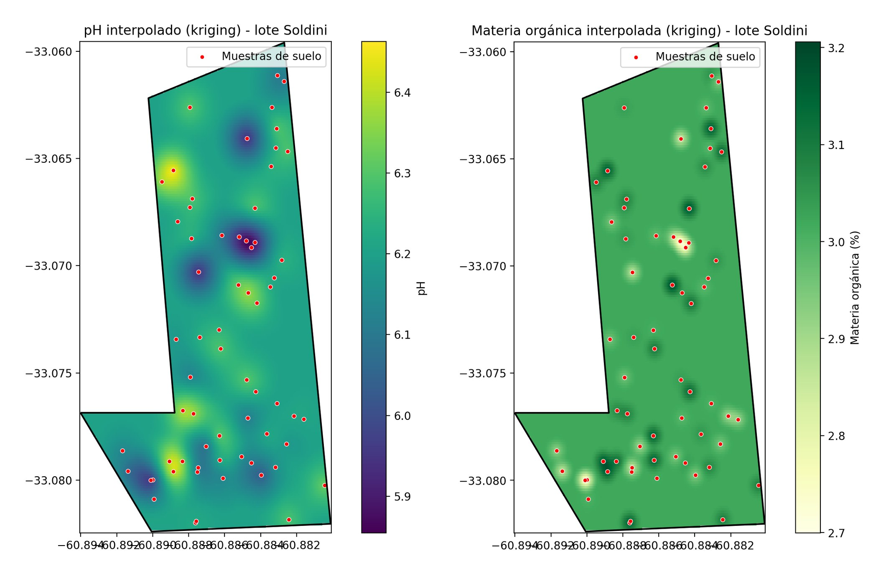
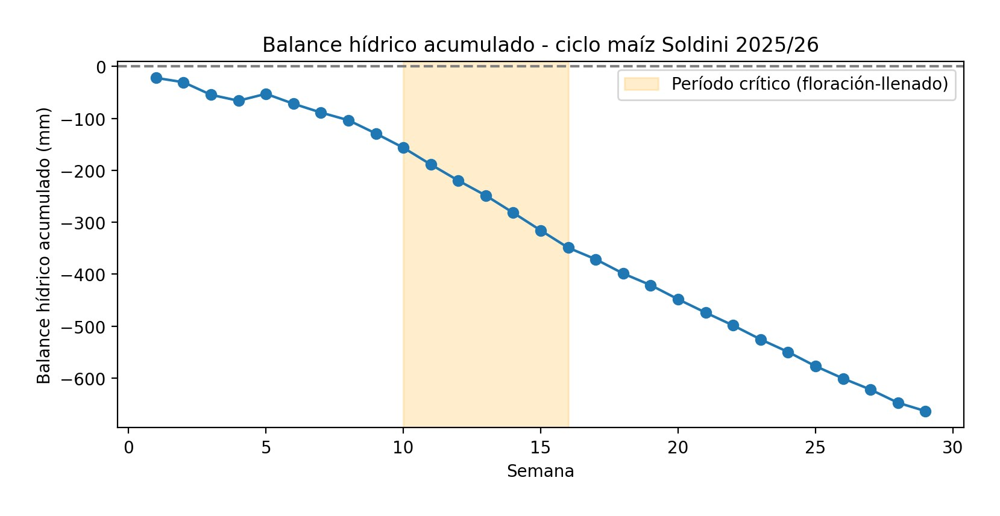
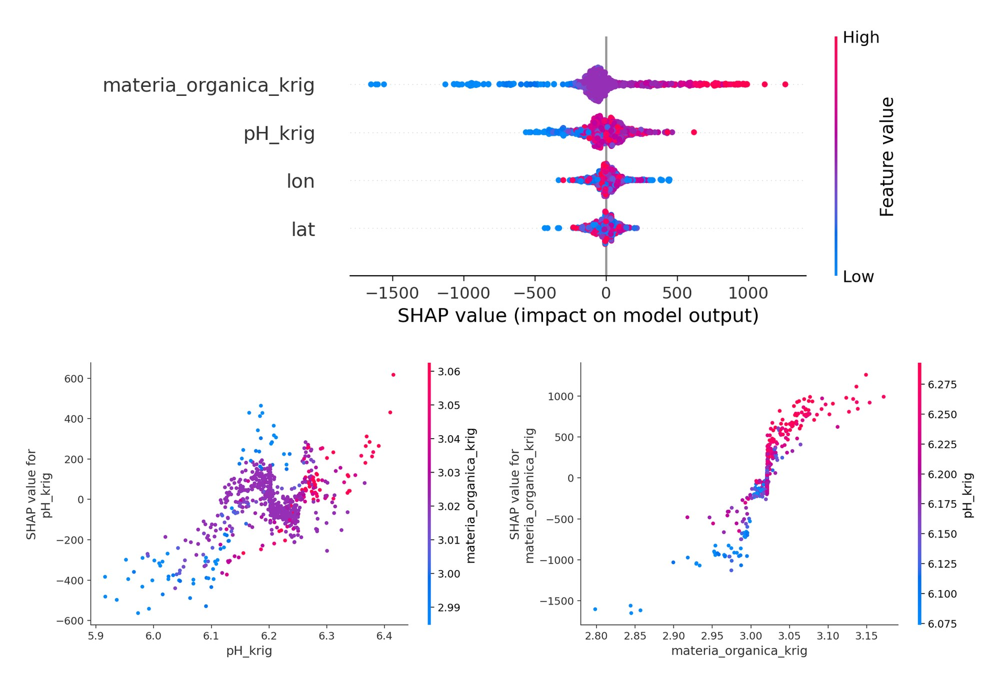
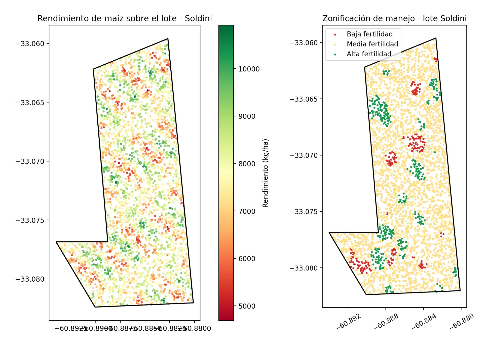

# 🌽 Diagnóstico de variabilidad de rendimiento en un lote de maíz — Soldini, Santa Fe

**Caso real de portfolio:** análisis de datos agropecuarios sobre un lote de maíz de **196,5 ha** (campaña 2025/26). A partir de monitor de cosecha, muestreo de suelo y clima, el proyecto identifica **por qué varía el rendimiento dentro del lote** y lo traduce en **zonas de manejo** validadas estadísticamente.

> ℹ️ **Los datos son simulados** con fines demostrativos, generados sobre un **polígono real** (Soldini, Santa Fe). Los resultados muestran la metodología, no el comportamiento de un lote productivo real.

---

## 🎯 El problema

Un productor o ingeniero agrónomo entrega tres fuentes de datos de un mismo lote y pregunta: *¿por qué hay sectores que rinden mucho más que otros, y qué puedo hacer al respecto?*

Este repositorio recorre el encargo completo, como un servicio de análisis de datos: desde el control de calidad de los datos crudos hasta un mapa de zonas de manejo con respaldo estadístico y un dashboard interactivo para presentar los resultados.

## 📦 Datos de entrada

| Dataset | Contenido | Tamaño |
|---|---|---|
| `cosecha_monitor.csv` | Monitor de rendimiento de la cosechadora (lat, lon, rendimiento, humedad de grano, velocidad) | 3.700 puntos |
| `muestreo_suelo.csv` | Muestreo de suelo georreferenciado (pH, materia orgánica, fósforo y nitrato) | 65 muestras |
| `clima_semanal.csv` | Precipitación y temperaturas semanales desde octubre de 2025 | 29 semanas |
| `lote_soldini.geojson` | Polígono del lote, dibujado con geemap | 196,53 ha |

Los cuatro archivos se colocan en la carpeta `data/`. El análisis usa pH y materia orgánica; fósforo y nitrato quedan disponibles para ampliarlo. El polígono se dibujó una sola vez con geemap (Earth Engine); no hace falta instalarlo para reproducir el análisis.

---

## 🔬 Metodología

El análisis está dividido en **5 scripts independientes**, uno por paso. Cada uno lee sus entradas de `data/` o de `outputs/` y guarda sus resultados en `outputs/`.

### Paso 1 — Control de calidad de los datos (`01_limpieza.py`)
Revisión de estructura, nulos y duplicados; verificación de rangos agronómicos plausibles y detección de outliers por IQR (1 outlier en 3.700 puntos, reportado y conservado). Mapa de rendimiento sobre el polígono real.

### Paso 2 — Interpolación de suelo por kriging (`02_kriging.py`)
Kriging ordinario (variograma esférico, PyKrige) para pasar de **65 muestras puntuales** a mapas continuos de pH y materia orgánica. Cada punto del monitor de cosecha recibe su valor interpolado.



Correlación con el rendimiento: **0,29 con pH** y **0,34 con materia orgánica**.

### Paso 3 — Balance hídrico (`03_balance_hidrico.py`)
Balance semanal (precipitación − evapotranspiración) con foco en el período crítico de **floración-llenado de grano** (semanas 10 a 16). Resultado: **219,9 mm de déficit** en ese período.



### Paso 4 — Modelo predictivo e interpretabilidad (`04_random_forest_shap.py`)
Random Forest (300 árboles, profundidad máxima 8) que predice el rendimiento a partir de pH y materia orgánica interpoladas, más latitud y longitud. Se interpreta con **SHAP** para saber cuánto y cómo aporta cada variable.



- **R² = 0,30** y **MAE = 701 kg/ha** en el set de prueba (20%).
- La **materia orgánica** es la variable de mayor peso, seguida del pH. El gráfico de dependencia muestra un punto de inflexión alrededor del **3,0%** de materia orgánica.

### Paso 5 — Zonas de manejo y validación estadística (`05_zonificacion_anova.py`)
KMeans (k = 3, elegido con el método del codo) sobre pH y materia orgánica estandarizados, con zonas ordenadas de menor a mayor pH medio. Luego, **ANOVA de una vía** sobre el rendimiento para comprobar que las zonas realmente difieren.



*Izquierda: rendimiento medido por el monitor de cosecha (paso 1). Derecha: zonas de manejo (paso 5).*

---

## 📊 Resultados

| Zona de manejo | Puntos | Rendimiento medio |
|---|---|---|
| Baja fertilidad | 228 | 6.707 kg/ha |
| Media fertilidad | 3.076 | 7.740 kg/ha |
| Alta fertilidad | 396 | 8.499 kg/ha |

- **Brecha de ~1.793 kg/ha** entre la zona de menor y la de mayor fertilidad.
- **ANOVA:** F = 242,38; p ≈ 1,2 × 10⁻⁹⁹; tamaño del efecto **η² = 0,116** (las zonas explican cerca del 12% de la variabilidad del rendimiento).
- La **materia orgánica** es el factor que más explica la variabilidad de rendimiento (importancia SHAP media de ~232 kg/ha, el doble que el pH, ~109 kg/ha).
- El **déficit hídrico** del período crítico se calcula a nivel de campaña y no entra al modelo: es un factor a considerar junto con el suelo, no una variable explicada por él.

**Lectura agronómica:** la zona de baja fertilidad es chica (alrededor del 6% de los puntos) y está concentrada en sectores definidos, que son los candidatos a manejo diferenciado (por ejemplo, muestreo más denso y dosis variable de fertilización). La zona de alta fertilidad (~11%) sostiene los mayores rendimientos.

---


---

## ⚠️ Limitaciones

Conviene tenerlas presentes al interpretar los resultados:

- **Datos simulados.** Sirven para demostrar el flujo de trabajo; no hay conclusiones agronómicas válidas para un lote real.
- **Kriging de materia orgánica con poca estructura espacial.** El mapa muestra una superficie casi uniforme (~3,0%) con "manchas" alrededor de cada muestra. Es posible que la interpolación aporte poca información entre puntos de muestreo, algo que podría estar relacionado con el escalón que aparece en el gráfico SHAP.
- **Latitud y longitud como predictores.** El Random Forest puede capturar estructura espacial que no explican el pH ni la materia orgánica: entre las dos suman una importancia SHAP (~115 kg/ha) comparable a la del pH (~109 kg/ha).
- **Validación optimista.** Se usa un único split aleatorio (`random_state=42`): puntos vecinos del monitor quedan en entrenamiento y prueba, lo que puede inflar las métricas. Una validación espacial (por bloques) probablemente daría métricas más conservadoras.
- **Rangos de suelo estrechos.** El pH interpolado va de ~5,85 a ~6,46 y la materia orgánica se concentra cerca de 3,0%. Las diferencias entre zonas (por ejemplo, 2,96% vs 3,06% de materia orgánica) son chicas en términos agronómicos absolutos.
- **Balance hídrico simplificado.** ET fija por etapa (34 mm/semana en el período crítico, 28 mm/semana en el resto), sin almacenaje de agua en el suelo ni coeficientes de cultivo.
- **Zonas definidas solo con suelo.** Las zonas se calculan con pH y materia orgánica (no con el rendimiento) y se nombran ordenando los clusters por pH medio. El p-valor del ANOVA es extremadamente chico en parte porque hay miles de puntos vecinos; por eso se reporta también el tamaño del efecto.
- **Coordenadas en grados.** El kriging se hace sobre latitud y longitud sin proyectar, una simplificación aceptable a la escala de un lote.

---

## 🗂️ Estructura del repositorio

```
maiz-soldini-analisis-lote/
├── scripts/
│   ├── 01_limpieza.py
│   ├── 02_kriging.py
│   ├── 03_balance_hidrico.py
│   ├── 04_random_forest_shap.py
│   └── 05_zonificacion_anova.py
├── assets/            # imágenes usadas en este README
├── requirements.txt
└── README.md
```


## 🛠️ Stack

**Python** · pandas · NumPy · SciPy · scikit-learn (Random Forest, KMeans) · **PyKrige** (kriging) · **SHAP** · GeoPandas · Shapely · Matplotlib · **Streamlit** · Plotly

---

**Sebastián** — Análisis de datos aplicado a sistemas productivos agropecuarios
GitHub: [@Sebas-Zarate](https://github.com/Sebas-Zarate) · LinkedIn: [TU-LINKEDIN-AQUÍ]
